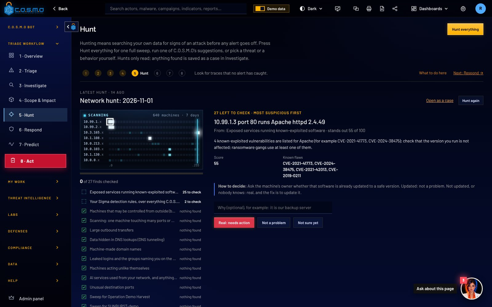

# cosmoplatform.ai

The marketing website for C.O.S.M.O, built and supported by Cypher, LLC. It is plain HTML, CSS and a little JavaScript: no build step, no frameworks, nothing to install, and it loads nothing from other websites. Open `index.html` in a browser to see it, or publish the folder with GitHub Pages.

## What is in this folder

| File or folder | What it is |
| --- | --- |
| `index.html` | Home page: hero, the platform, the feature rows, auto triage diagram, the eight-step workflow, where it runs, how to buy |
| `government.html` | Offline mode, signed updates, classification markings, DoD sign-in rules, AI for government, how to buy |
| `security.html` | How C.O.S.M.O protects itself, Proof of Defense, the standards it follows |
| `contact.html` | The demo request form and direct contact details |
| `thanks.html` | Shown after the form is sent by a visitor whose browser has JavaScript switched off |
| `404.html` | Shown by GitHub Pages for any address that does not exist |
| `css/site.css` | All the styling. Colors are at the top, under `:root` |
| `js/site.js` | Motion, the workflow tabs, the counters and the contact form. Every page is readable without it |
| `assets/img/` | Screenshots, logos and the C.O.S.M.O Bot portrait |
| `CNAME` | Tells GitHub Pages the site lives at `cosmoplatform.ai`. Leave it as is |
| `.nojekyll` | Tells GitHub Pages to publish the files exactly as they are. Leave it as is |

## Changing the text

Open the page in any text editor (VS Code, TextEdit in plain-text mode, Notepad) and change the words between the tags. For example, the home page headline in `index.html`:

```html
<h1 id="hero-h">Bringing order to <span class="accent">cyber operations.</span></h1>
```

The header (logo and menu), the "built and supported by Cypher, LLC" section and the footer are repeated on every page. If you change one of them, make the same change in all six `.html` files; a search-and-replace across the folder does it in one go. In `404.html` the links start with `/`, because GitHub Pages shows that page at any address.

Rules the copy follows, so new text matches:

- The product is always written **C.O.S.M.O**, with the dots. The assistant is **C.O.S.M.O Bot**. Never name the AI model behind the bot.
- American spelling: defense, license, organization.
- Plain words first, technical names after, in brackets if needed.
- C.O.S.M.O "follows" a standard. Never write "certified" or "compliant".
- Every claim must be true of the product today. No invented customers, quotes, numbers, awards, prices or contract numbers.

## Swapping a screenshot

Screenshots sit inside device frames built in CSS: a laptop, a desktop monitor and a phone. The picture is an ordinary `` inside `.screen`, so swapping it means changing one `src`:

```html
<figure class="device-laptop">
  <div class="lid"><div class="screen"></div></div>
  <div class="base"></div>
</figure>
```

- **Laptop and monitor** screens are 16:10. A 1440 x 900 screenshot fits exactly; other sizes are cropped from the top.
- **Phone** (`.device-phone`) suits a tall, narrow picture, about 430 x 650.
- **Window** (`.window`) is a plain app window with a title bar, for wide pictures such as the 3D map.

Steps:

1. Save the new picture as a JPEG, about 1440 pixels wide and under about 250 KB.
2. Put it in `assets/img/`. Either give it the same name as the one it replaces, or a new name and change the `src` in the page.
3. Update its `alt="..."` text: one sentence describing what is on the screen, for people using screen readers.

The screenshots come from the C.O.S.M.O app with fictional demo data, and the work order card is the top of a real work order PDF the app produced. When the app changes, replace them with fresh ones. Two things on the home page are drawn in HTML rather than being pictures, and are labeled as illustrations: the moving Triage list inside the first laptop, and the "Why it scored 87" card.

The workflow section shows a different screenshot for each of the eight steps; they are the eight `` tags inside the monitor in `index.html`, in step order.

## Changing where the contact form sends email

GitHub Pages cannot send email, so the form goes through **the site-forms Worker (Resend)** (formsubmit.co), a free service that emails each form to an address you choose. No account is needed.

The address is set in **one line** of `contact.html`, the `<form>` tag:

```html
<form class="form" data-email="janderson@cypher-llc.com" action="https://formsubmit.co/janderson@cypher-llc.com" method="POST">
```

Change the address in **both** places on that line: `data-email` is what the page uses normally, and `action` is used only by visitors who have JavaScript switched off. The address shown under "Or reach us directly", and the one in the footer of each page, are separate; change them too if they should change.

### The one-time activation email

The first time anyone sends the form to a new address, the site-forms Worker (Resend) does not deliver the message. Instead it sends that address an email titled something like "Action Required: Activate the site-forms Worker (Resend)". Open it and press **Activate Form**. From then on every request arrives as a normal email.

So after you publish the site, or after you change the address: send yourself a test request from the live site, look for the activation email (check the spam folder), and press the button. Until you do, visitors see a "did not go through" message with the phone number and email, so no one is left stuck.

### Spam protection

- The form has a hidden `_honey` field. People never see it; spam bots fill it in, and the site-forms Worker (Resend) then drops the message.
- the site-forms Worker (Resend)'s own "I am not a robot" check stays on for visitors without JavaScript. When JavaScript is on, the form is sent in the background and the site-forms Worker (Resend) does not show that check; the hidden field still works.
- After activation, the site-forms Worker (Resend) can give you a random string to use instead of the email address, so the address is not visible in the page. If you use it, put that string in both places on the `<form>` line.

The email subject is set by `<input type="hidden" name="_subject" ...>` just below the `<form>` line.

## Motion

The page fades sections in as you scroll, floats the hero laptop, draws a slow starfield, lights the workflow steps as you scroll, and moves dots along the auto triage diagram. All of it is written by hand in `css/site.css` and `js/site.js`, animates only position and opacity, and switches off completely for visitors whose computer asks for reduced motion. Without JavaScript every section is simply shown.

## Publishing on GitHub Pages

1. Put the contents of this folder at the top level of a GitHub repository (or in a `docs/` folder).
2. In the repository: **Settings**, **Pages**. Under "Build and deployment", choose **Deploy from a branch**, pick the branch and folder, and save.
3. Under **Custom domain**, enter `cosmoplatform.ai` (the `CNAME` file already says this). Tick **Enforce HTTPS** once GitHub offers it.
4. At the company that holds the domain, point it at GitHub Pages: four `A` records for `cosmoplatform.ai` to `185.199.108.153`, `185.199.109.153`, `185.199.110.153`, `185.199.111.153`, and a `CNAME` record for `www` to `<your-github-user>.github.io`. GitHub's Pages help page "Managing a custom domain" has the current values.

## Privacy

The site loads nothing from other websites: no web fonts, no analytics, no trackers. It uses the computer's own system fonts. The only outside request is the contact form going to the site-forms Worker (Resend) when someone presses Send.

## Documents

The C.O.S.M.O PDFs are kept in this repository only, on the [`documents` branch](https://github.com/janderson715/Cosmo-Site/tree/documents). They are not part of the website and nothing on the site links to them.
